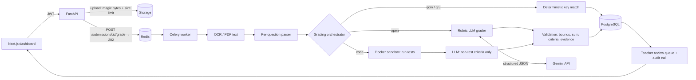

# ExamESICorrector: AI-assisted exam grading with human oversight

ExamESICorrector grades exam copies (PDF or scans) question by question:
- **MCQ** with deterministic key matching;
- **open-ended answers** with a rubric-based LLM grader whose output is validated server-side;
- **Python code** by running it against hidden and public tests in a locked-down sandbox.

Uncertain, invalid or suspicious grades go to a **teacher review queue**, and every grade change is audited. A reproducible **evaluation framework** measures agreement with human grades.

    

## What is implemented (and what is not)

| Area | Status |
|---|---|
| Rubric-based LLM grading (Gemini, structured JSON output, retries, timeouts, cost tracking) | ✅ implemented, unit-tested, **evaluated live** (MAE 0.062 vs baseline 0.295 on dev split) |
| Server-side validation: score bounds, criteria sum, rubric coverage, **evidence quotes checked against the answer** | ✅ |
| Prompt-injection defences (delimited untrusted data + heuristic detector that forces review) | ✅ + adversarial test items |
| Deterministic MCQ (single and multiple answer, invalid or ambiguous keys flagged) | ✅ |
| Code grading in a Docker sandbox (no network, read-only, non-root, CPU, memory and pids limits, hidden tests) | ✅ implemented; isolation tests run in CI, **not run locally** |
| Async pipeline: upload → OCR → parse → grade → persist → review (Celery or in-process), idempotent jobs | ✅ |
| Teacher review queue, approve or override, audit trail; teacher decisions survive re-grading | ✅ API + UI |
| Evaluation framework (dataset, metrics with CIs, experiment runner, reports) | ✅ baseline and LLM grader measured; comparison reports generated |
| Alembic migrations, CI (lint, types, tests, migrations on PostgreSQL, pip-audit, sandbox, frontend build) | ✅ |
| Retrieval over course material (RAG) | ❌ not built: there is no course-material corpus yet; the exam's correction document is passed as labelled context instead |
| Human-reviewed evaluation labels | ⏳ labels are drafts; run `python -m eval.review_labels` |
| Login rate limiting, httpOnly-cookie auth, other sandbox languages | ⏳ planned (see [Limitations](#limitations-and-future-work)) |

## Architecture



**Grading one open answer:**
1. Resolve the rubric. A teacher rubric is normalised. With no rubric but a reference answer, a single explicit criterion is used and review is forced. With neither, the answer is not graded: `needs_configuration`.
2. Build the prompt (`app/grading/prompts/open_v2.py`). The student answer goes inside an escaped `<student_answer>` block that the model is told is data, not instructions.
3. Call Gemini with a JSON schema. Transient errors (429, 5xx, timeouts) get bounded exponential-backoff retries; permanent errors do not.
4. Validate. Every rubric criterion must appear exactly once, and each score must be within its bounds. The **total is computed server-side**, and each evidence quote must appear in the answer. Invalid output is re-asked once, then marked `grading_failed`. It is never stored as a grade.
5. Decide on review. Low confidence, the model asking for review, unverified evidence, high self-consistency spread, a suspected injection, plagiarism, a missing rubric or any failure each mark the item `pending_review`, and the score becomes **provisional** until a teacher decides.

## Tech stack
- **Backend:** FastAPI, SQLAlchemy 2, Alembic, Pydantic 2.
- **Workers:** Celery + Redis.
- **Data:** PostgreSQL (SQLite for local runs).
- **AI:** Google Gemini via `google-genai` (default `gemini-3.8-flash`); provider-independent interface in `app/llm/`.
- **OCR:** pdfplumber / pypdf + Tesseract.
- **Sandbox:** Docker CLI with a stdlib-only harness.
- **Frontend:** Next.js 14, TypeScript, Tailwind.
- **Quality:** pytest, ruff (incl. bandit rules), mypy, pip-audit, GitHub Actions.

## Getting started

### 1. Configure
```bash
cp backend/.env.example backend/.env
# then edit backend/.env:
#   SECRET_KEY=<python -c "import secrets; print(secrets.token_urlsafe(48))">
#   GEMINI_API_KEY=<key from https://aistudio.google.com/apikey>   (optional: without it, open answers go to review)
```
Never commit `.env`. On the Gemini **free tier**, prompts may be used by Google to improve its products, so do not send real student data there.

### 2a. Run everything with Docker Compose
```bash
docker compose up --build        # API on :8000 (runs `alembic upgrade head` first), worker, Postgres, Redis
cd frontend && npm install && npm run dev   # UI on :3000
```
Code execution is **disabled** in Compose on purpose. Enabling it needs Docker-daemon access from the worker, which is root-equivalent; see [docs/SANDBOX_THREAT_MODEL.md](docs/SANDBOX_THREAT_MODEL.md).

### 2b. Run locally without Docker
```bash
cd backend
python -m venv .venv && .venv/Scripts/activate        # Windows (Linux/macOS: source .venv/bin/activate)
pip install -r requirements-dev.txt
# in .env: DATABASE_URL=sqlite:///./exam.db, GRADING_EXECUTOR=inline, SEED_DEMO_DATA=true
alembic upgrade head
uvicorn app.main:app --reload --port 8000
```
- **Code grading:** set `CODE_SANDBOX=docker` and run `docker pull python:3.12-slim` (needs a local Docker daemon).
- **Database created before Alembic:** run `alembic stamp 0001_baseline && alembic upgrade head`. Legacy grades whose scale cannot be recovered are put in the review queue instead of being guessed.

### API
Interactive docs are at `http://localhost:8000/docs`. Main endpoints:

| Endpoint | Purpose |
|---|---|
| `POST /api/auth/register`, `POST /api/auth/login`, `GET /api/auth/me` | auth (JWT) |
| `POST /api/upload` | upload a PDF or image; returns an opaque `file_uri` key |
| `POST /api/exams/from-pdf`, `POST /api/exams`, `PATCH /api/exams/{id}/questions/{qid}` | create exams; set the answer key, rubric and tests per question |
| `POST /api/submissions` | submit a copy (duplicate files are rejected with 409) |
| `POST /api/submissions/{id}/grade` → `GET /api/submissions/{id}/job` | async grading and its status (idempotent) |
| `GET /api/scores/{submission_id}`, `GET /api/scores/{id}/audit` | grade details; audit trail (teachers) |
| `GET /api/reviews`, `POST /api/reviews/{score_item_id}` | review queue; approve or override |
| `POST /api/evaluate/{id}` | synchronous grading, kept for backward compatibility |

### Rubric and test formats
```json
[{"id": "def", "description": "Définit la récursivité", "points": 2},
 {"id": "base", "description": "Mentionne le cas de base", "points": 1}]
```
```json
{"mode": "function", "entrypoint": "factorielle",
 "tests": [{"id": "t1", "args": [5], "expected": 120},
           {"id": "h1", "args": [10], "expected": 3628800, "hidden": true}]}
```
For code questions, a rubric criterion with `"kind": "tests"` is scored from the test results. Other criteria (for example code quality) are graded by the LLM, which receives the test results as evidence.

## Testing
```bash
cd backend
pytest -m "not live and not sandbox"     # 176 tests; LLM mocked, SQLite in memory
pytest -m sandbox                        # real Docker isolation tests (needs docker + python:3.12-slim)
RUN_LIVE_LLM_TESTS=1 pytest -m live      # 2 opt-in checks against the real Gemini API (costs quota)
ruff check . && ruff format --check . && mypy app/llm app/grading app/sandbox eval/metrics.py eval/dataset.py eval/report.py eval/run_eval.py
cd ../frontend && npx tsc --noEmit && npm run build
```
The tests cover:
- authentication and authorization;
- grading schema invariants;
- missing or invalid rubrics and keys;
- paraphrased, partial and invalid answers;
- malformed LLM output, timeouts, rate limits and the retry policy;
- prompt-injection cases;
- OCR failures;
- job idempotency and retries;
- the review and audit flow;
- sandbox harness behaviour;
- metric correctness against hand-computed values.

## Evaluation
The methodology is in [docs/EVALUATION.md](docs/EVALUATION.md) and the dataset is described in its [DATASHEET](backend/eval/datasets/grading_v1/DATASHEET.md).
```bash
cd backend
python -m eval.run_eval --experiment eval/experiments/baseline.json --split dev
python -m eval.run_eval --experiment eval/experiments/flash_open_v2.json --split dev     # needs GEMINI_API_KEY
python -m eval.report --compare eval/runs/<run_a> eval/runs/<run_b>
```

**Measured (2026-10-11):** baseline and two Gemini Flash prompts. Labels are unreviewed drafts — agreement is with those drafts, not with independent human graders. Both LLM runs are partial due to free-tier rate limits (resume with `--resume`).

| Grader | Split | Coverage | MAE [95% CI] | Within ±10% | QWK | Review rate | Cost/answer |
|---|---|---|---|---|---|---|---|
| Similarity baseline | dev (41) | 100% | 0.295 [0.201, 0.399] | 39.0% | 0.388 | 0% | $0.000 |
| **Gemini Flash · open_v1** (minimal) | dev (18) | 88.9% | **0.062** [0.000, 0.188] | **93.8%** | **0.847** | 16.7% | $0.001 |
| **Gemini Flash · open_v2** (production) | dev (12) | 83.3% | 0.100 [0.000, 0.300] | 90.0% | 0.737 | 25.0% | ~$0.001 |
| Similarity baseline | test (25) | 100% | 0.410 [0.267, 0.547] | 32.0% | 0.151 | 0% | $0.000 |

Both LLM prompts dramatically outperform the baseline. The v2 production prompt sends more items to review (25% vs 16.7%) because it enforces evidence verification and injection detection — a higher review rate is the intended trade-off for safety. The CIs overlap, so the MAE difference between v1 and v2 is not statistically significant on this sample size.

The baseline gives correct paraphrases almost no credit (MAE 0.74 on that category) and gives 3.98/4 to code that does not compile. Both LLM prompts review-flag all items with unverified evidence.

**Cost and latency:** Gemini Flash costs ~$0.001 per answer at list price. The comparison report is at [`eval/reports/comparison_dev.md`](backend/eval/reports/comparison_dev.md).

## Screenshots
To be added: dashboard, grading flow, score breakdown with criteria, review queue, audit trail.

## Security
See [docs/SECURITY.md](docs/SECURITY.md) for the audit findings and fixes, and [docs/SANDBOX_THREAT_MODEL.md](docs/SANDBOX_THREAT_MODEL.md) for code execution.

## Limitations and future work
1. **Complete the LLM experiments:** both runs are partial due to free-tier rate limits. Resume with `--resume eval/runs/<run_dir>`. Then run self-consistency (`flash_open_v2_sc3.json`) and do a final test-split run after reviewing labels.
2. **Grow the dataset** to 100+ items, with independent double-grading, and with real anonymised answers under consent (`eval/export_corrections.py`).
3. **Calibrate review thresholds** (confidence, spread) on dev data from the review-flag analysis.
4. **Run the sandbox under gVisor** (`SANDBOX_RUNTIME=runsc`) on a dedicated worker host, and add more languages.
5. **Auth hardening:** rate limiting, httpOnly cookies, token revocation.
6. **ORM typing:** migrate models to SQLAlchemy 2 `Mapped[...]` so the whole backend can be type-checked.
7. **RAG over course material** with source attribution, once a corpus exists.
8. **OCR quality:** handwriting is a major source of error that this project does not yet measure.

## Repository layout
```
backend/app/
  api/routers/      FastAPI routers (auth, classes, exams, files, submissions, scores, reviews)
  grading/          MCQ, open-ended, code graders; rubric, validation, prompts, injection heuristic
  llm/              provider interface, Gemini adapter, retries, pricing
  sandbox/          Docker sandbox + in-container harness
  services/         storage, OCR, parsing, submission pipeline, jobs
backend/worker/     Celery app and tasks
backend/alembic/    migrations
backend/eval/       dataset, metrics, runner, reports, label review
backend/tests/      unit, API and sandbox integration tests
frontend/           Next.js dashboard (incl. /dashboard/reviews)
docs/               evaluation, security, sandbox threat model
```
